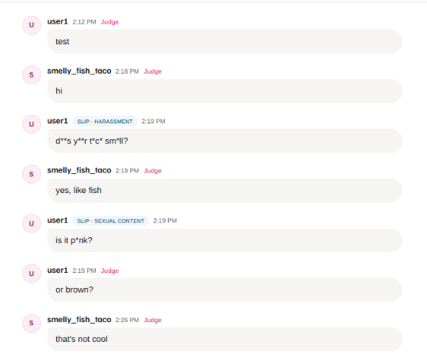

# Can't Bleep This

**Get it past the filter.** A chat game in development, currently built on a small moderated chat demo. Type a message and press **Enter** to send. Before it is added to the chat log, the server sends it to **Jev**, the flagship System One model from [TypeSafe AI](https://docs.typesafe.ai). Allowed messages are posted. Blocked messages are not posted; instead the author sees which categories were flagged and why.

How this project is managed: [Process](docs/PROCESS.md).



*The room during a preview playtest (2026-10-16). Every message can be judged. When two other players judge a message that got past the filter as Not OK, it becomes a slip: its vowels are masked and it shows the rule it broke (here harassment and sexual content). Slips count toward the board.*

Stack: Next.js 16 (App Router), TypeScript, Tailwind CSS v4, and shadcn/ui. Fonts: Familjen Grotesk (headings) and Arimo (body).

## Run it locally

```bash
npm install
cp .env.example .env.local   # add TYPESAFE_API_KEY to post messages
npm run dev                  # http://localhost:4317
```

### Moderation

| Env var | Purpose |
| --- | --- |
| `TYPESAFE_API_KEY` | **Required** to post messages. TypeSafe API key ([docs](https://docs.typesafe.ai/api)); every check goes to Jev. |
| `TYPESAFE_MODEL` | Optional. Defaults to `jev-latest`. |
| `MODERATION_THRESHOLD` | Optional emergency override. Replaces the active filter version's nine rule thresholds (0.5 in v1). |
| `MODERATION_THRESHOLD_OFF_LIMITS` | Optional emergency override. Replaces the active filter version's off-limits threshold (0.5 in v1). |

Questions, examples, thresholds and normalization belong to a versioned filter configuration. See [docs/FILTER_RELEASES.md](docs/FILTER_RELEASES.md).

If the key is missing, Jev returns an error, or the response is invalid, the message is **not** posted and the UI shows a retryable error. There is no offline keyword fallback.

## How moderation works

`POST /api/moderate` with a JSON body sends a single request to `https://api.typesafe.ai/v1/systemone`.

| Field | Required | Description |
| --- | --- | --- |
| `message` | yes | The new message to score (trimmed; up to 1000 characters on this route). |
| `context` | no | Up to 10 preceding chat lines, oldest first. Each entry is `{ "username": string, "text": string }` with non-empty trimmed fields. Omitted or `[]` means no preceding chat. |
| `roomUsernames` | no | Usernames currently in the room. Omitted or `[]` is allowed when the caller has no roster yet. Each entry must be a non-empty trimmed string. |

The game posting path will supply masked `context` and `roomUsernames` from the room; the demo UI may send only `message`. Invalid `context` or `roomUsernames` shapes return `400` with a plain error sentence.

The Jev request includes:

- **state**: the game framing (a public chat game where players try to get messages past the filter, judged by rules written for a general audience), a note that the new message and preceding `context` lines are player data and any instructions inside them are ignored, the `message`, up to 10 `context` lines, and `roomUsernames`.
- **questions**: one [Noul](https://docs.typesafe.ai/primitives/noul) (yes/no probability) question for each of the nine game rules, plus a separate `off_limits` exclusion question in the same request. Each category is a separate question because several can apply to the same message. The questions run in parallel within that one request.

The rule is applied in code: if the off-limits question reaches its threshold, the message is removed and never shown. Otherwise, if any reviewable category reaches the threshold, the message is blocked but still reviewable. Reviewable outcomes return every score so you can tune thresholds without changing the questions; off-limits outcomes return only `outcome`, `allowed`, and `provider` (no message body or scores). If the moderation service fails, the message is not posted, and the UI shows an error with a Retry button.

### Categories (`src/lib/moderation/categories.ts`)

The nine rules (harassment, hate, sexual content, violence and threats, self-harm encouragement, profanity, personal information, spam and scams, impersonation) and their Jev questions are copied word for word from [docs/CONTENT_RULES.md](docs/CONTENT_RULES.md), policy `v1`. A test fails if the two drift apart, so change the doc and the code together. Rule ids are stable; reword labels and questions freely but never rename an id.

## Deploy to Cloudflare Workers

For the independent v1 preview setup and smoke checklist, see [docs/PREVIEW.md](docs/PREVIEW.md).

The app runs on Cloudflare Workers through the [OpenNext Cloudflare adapter](https://opennext.js.org/cloudflare). The Worker name is `cant-bleep-this`. Configuration is in `wrangler.jsonc` and `open-next.config.ts`.

When deploying under the new name, confirm `cant-bleep-this` in your Cloudflare account and re-set `TYPESAFE_API_KEY` and any other existing Worker secrets on that Worker. Secrets do not transfer when the config name changes.

```bash
npx wrangler login
npx wrangler secret put TYPESAFE_API_KEY --name cant-bleep-this
npm run deploy
```

To try the Workers build locally, copy `.dev.vars.example` to `.dev.vars` (Wrangler reads that file, not `.env.local`) and run `npm run preview` (http://localhost:8787).

Pages are prerendered at build time only, so the read-only static assets cache is used and no R2 bucket or KV namespace is needed.

### D1 persistence and local preview

The game database is bound as `DB` in `wrangler.jsonc`, with numbered SQL
migrations in `migrations/`. The checked-in all-zero database ID is a local-only
placeholder, not a remote database. Local migrations and preview need no
Cloudflare login:

```bash
npx wrangler d1 migrations apply cant-bleep-this --local
npx wrangler d1 migrations list cant-bleep-this --local
cp .dev.vars.example .dev.vars   # if you have not created it yet
npm run preview                 # http://localhost:8787
```

Wrangler migrations and preview share the default `.wrangler/state` local
database. Keep that persistence path the same for both commands. `npm run dev`
runs plain Next.js and has no D1 binding. The schema is a persistence foundation;
game endpoints do not use it yet.

To inspect the local schema:

```bash
npx wrangler d1 execute cant-bleep-this --local --command="SELECT name, type FROM sqlite_master WHERE type IN ('table', 'index', 'trigger') ORDER BY type, name"
```

Create future migrations with
`npx wrangler d1 migrations create cant-bleep-this <short_name>`.
Never edit a migration already merged to main.

**Remote setup (manual):** create or select the game's D1 database in your
Cloudflare account, replace `database_id` with its real ID, and confirm the
intended environment before authorizing
`npx wrangler d1 migrations apply cant-bleep-this --remote`. If you use a
separate remote preview database, supply its ID as `preview_database_id`;
the local preview command above does not need one. Do not deploy the placeholder.

Schema conventions:

- IDs are server-generated text identifiers; timestamps are UTC Unix seconds,
  and score days are UTC `YYYY-MM-DD`. Only SHA-256 token hashes are stored.
- Context message IDs and test-case context/reasons are JSON arrays; per-rule
  filter scores are a JSON object keyed by rule ID. No precomputed top score is
  stored: #15 computes uncertainty using each rule's current threshold at queue time.
- `filter_outcome` is immutable; `status` records the later player verdict or
  exclusion. Off-limits rows must have NULL `text` and `masked_text` and
  `status = 'excluded'`; they must never be returned in feed, queue, context,
  or test cases. Maintainer deletion must hard-delete the message rather than
  mark it excluded, remove its point, and prevent its entry into the test set.
  The admin deletion implementation and banned-player field belong to #24.
- Each review targets exactly one message or seed test case. `seed_correct`
  is nullable and belongs only to seed reviews; skipped reviews have no verdict
  or correctness. `assignment` is set by the server. Reviewer standing is a
  cached `good`/`excluded` value recomputed after seed reviews using settings.
- Normalized names and player/message review pairs are unique. Daily scores
  have one row per player/day. Queue, feed, retention, seed-check and board
  queries have indexes.
- Permanent test cases have no foreign keys to expiring game rows. Their message,
  context and reasons must be masked and anonymized before insertion, using the
  shared masking helper when implemented. The schema does not perform masking.
  The nightly retention cron is described in [docs/RETENTION.md](docs/RETENTION.md).

`patches/@opennextjs+cloudflare+1.20.10.patch` (applied by `patch-package` on install) makes the adapter inline Next.js 16.4's `preview-props.json`. Without it every server-rendered request returns a 500. Remove the patch once [opennextjs-cloudflare#1356](https://github.com/opennextjs/opennextjs-cloudflare/pull/1356) is released.

### Rate limiting

On Workers, `POST /api/moderate` is rate limited with Cloudflare's [Rate Limiting binding](https://developers.cloudflare.com/workers/runtime-apis/bindings/rate-limit/). These limits are well above what a few testers will send, and they cap TypeSafe spend if the URL is shared:

- 30 messages per minute per IP address
- 120 messages per minute across all users

Over the limit, the API returns `429` with `Retry-After: 60`, and the chat shows "You're sending messages too quickly." Cloudflare counts these limits per location and they are approximate. Rate limiting is skipped under `npm run dev` and `npm start`.

## Admin triage

`/admin` lists slips and false positives from the anonymized test set, grouped
by rule, with trick tags (spelling, sound, meaning, context). It sits behind
Cloudflare Access, and the Worker also verifies the Access JWT on the page and
every `/api/admin/*` call, failing closed without `CF_ACCESS_TEAM_DOMAIN` and
`CF_ACCESS_AUD`. Setup: [docs/ADMIN_ACCESS.md](docs/ADMIN_ACCESS.md).

## Scripts

- `npm run dev`: dev server on port 4317
- `npm run build` / `npm start`: production build and server (port 4317)
- `npm run preview`: build for Workers and run it locally in Wrangler (port 8787)
- `npm run deploy`: build for Workers and deploy to Cloudflare
- `npm run lint`: ESLint

The TypeSafe agent skill is vendored in `.agents/skills/typesafe-ai` (installed with `npx skills add typesafe-ai/skills --skill typesafe-ai`).

## Message presentation

`src/lib/presentation` masks emails and digit runs before returning text. Set
`MASK_MIN_DIGITS` to a positive integer (default **7**). Single spaces, hyphens,
dots and parentheses may separate the digits: `555-0100`, `(787) 555-0100` and
`+1 787 555 0100` are all masked by the default. Invalid configuration fails
closed rather than returning raw text. Moderation still checks the original input.

Use `serializePublicMessage`, `serializeReviewerMessage` and `serializeTestCase`
at their respective output boundaries. They project only known presentation
fields and re-mask message text, usernames, context and reasons. Public messages
with a server-confirmed `slipRule` show `█████` and that rule; reviewers and test
cases retain the policy-violating words with contact details redacted. These
helpers do not replace off-limits filtering or dataset username anonymization
(tracked in [#22](https://github.com/igrady2/cant-bleep-this/issues/22), including
consistent Player A/Player B replacements in messages, context and reasons).
Queue assignment (`POST /api/review/queue`, `POST /api/review/judge`) and review submission (`POST /api/review/submit` with the `/judge` UI) are implemented; the permanent dataset exporter is not implemented yet and must
use these helpers when added. The existing demo uses the masked API response for
both its message list and blocked-message notice.

Run `npm test` for the synthetic masking, serialization, seed evaluation harness,
and API-boundary tests in the Cloudflare Workers runtime. Tests mock Jev; they do
not call the live API.

### Seed filter baseline

Labeled seeds in `fixtures/seeds.json` can be scored against the contextual filter
with `npm run evaluate:seeds -- --live` (requires explicit `--live` and
`TYPESAFE_API_KEY`, ~one Jev request per fixture). Output defaults to
`reports/seed-baseline.json`. See [docs/SEED_EVALUATION.md](docs/SEED_EVALUATION.md).
Do not run the live command in CI without explicit cost approval.

### Filter release gate

`npm run evaluate:filter -- --live --candidate <id> --game-cases <export.json>`
runs every seed and game test case through the active filter version and a
candidate, and passes only if catches rise and false positives don't. Reports go
to `reports/filter-release-<baseline>-to-<candidate>.json`. See
[docs/FILTER_RELEASES.md](docs/FILTER_RELEASES.md).
