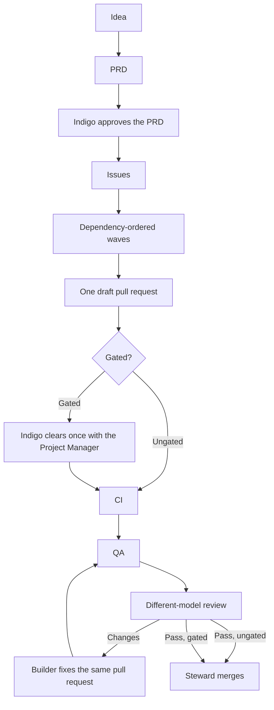

# Process

Indigo Grady owns the product. He approves the PRD, and he clears a gated pull request once. The game is specified in the [PRD](PRD.md). This page is how a change reaches `main`.

## Roles

| Role | What they do |
| --- | --- |
| Product owner | Indigo. Approves the PRD and clears each gated pull request once. |
| Project Manager | Orchestrates the work and brings each gated pull request to Indigo once. |
| PRD Writer | Claude writes the PRD. |
| Issue Planner | Turns an approved PRD into issues. |
| Builder | Cursor, Codex, Claude, or Grok. A cheaper model takes the first pass. Cursor fast mode stays off. The Builder opens the pull request and does not merge it. |
| QA / Test Runner | Checks the head SHA, mergeability, the issue's acceptance criteria, the tests, and lint and CI. A failure goes to the Builder and the Project Manager. QA does not merge. |
| Reviewer | A different LLM from the Built by LLM. |
| Steward | Runs or routes the different-model review. Merges after CI, QA, and that review pass, and records the review on the project board. |
| Release & Status | Build order, standups, and release notes. |

## Review routing

Routing follows **Built by LLM**. The reviewer LLM is never that LLM. Cursor is the product shell, so a Cursor build uses whichever row matches the LLM underneath.

| Built by LLM | Reviewer LLM |
| --- | --- |
| Grok | Codex or Claude |
| Codex | Grok or Claude |
| Claude | Grok or ChatGPT (Codex) |
| Composer | Grok, Codex, or Claude |

When Grok is an allowed reviewer, Grok via Steward counts.

## Flow

Each issue has one draft pull request. Fixes stay on that pull request and branch.

A pull request is gated when it changes moderation, schema, or auth, adds a dependency, affects cost, or changes more than about 400 lines of application code. Fixtures, seeds, and lockfiles do not count toward that line count.

QA checks the head SHA and mergeability, along with acceptance criteria, tests, and lint and CI. A failure goes to the Builder and the Project Manager. QA does not merge.

Steward merges an ungated pull request when CI, QA, and a different-model review have passed. A gated pull request is cleared once by Indigo, with the Project Manager. Steward merges it after those same three checks. That clearance is the only ask. The Builder does not merge either path.

Steward runs or routes the review. If review requests changes, the Builder fixes them on the same pull request. The change goes back to QA before the next merge attempt. That attempt still needs passing CI, QA, and a different-model review.

## Tests and paid API runs

Tests and CI use mocks only. CI does not make a live paid API call. A paid API run outside CI, such as a live seed baseline, waits for Indigo's approval and a call count.

## Pull request body

Every pull request fills the fields in `.github/pull_request_template.md`, using these names:

- **Closes**
- **Built by model** and **Built by LLM**
- **Reviewed by model** and **Reviewed by LLM**. The reviewer LLM differs from the Built by LLM. Steward records the same pair on the project board.
- **Scope**, each answered Yes or No: In the PRD? More than 400 lines? New dependency? Schema, auth, or moderation change? Cost impact? Deviations from the PRD? The line-count answer uses application code only, as above.
- **What changed**
- **Verification**

Labels: `built-by:cursor`, `built-by:codex`, `built-by:claude`, `built-by:grok`, `priority:high`, `priority:med`, `priority:low`, `size:S`, `size:M`, `size:L`, `blocked`, and `needs-approval`.

Milestones follow the PRD: `1 - Rules`, `2 - Filter in context`, `3 - Build v1`, `4 - Private beta`, `5 - Launch`.
